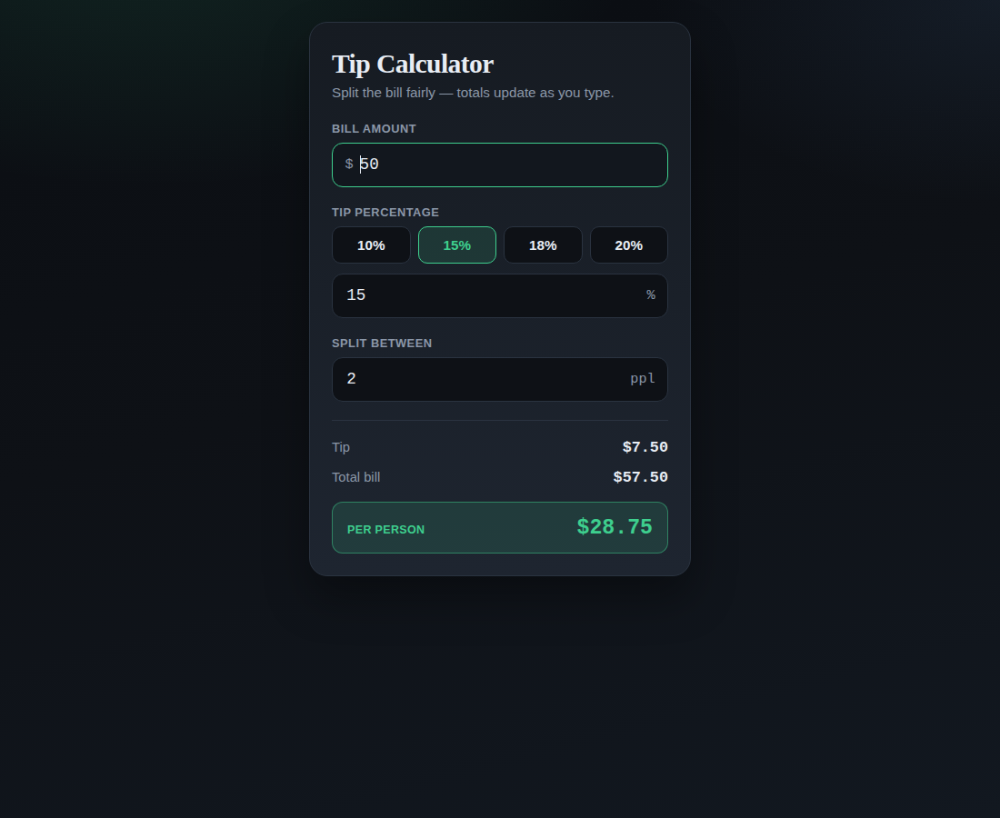

# Tip Calculator

A single-file tip calculator built with Cursor.

Open `index.html` in a browser. No build step, no dependencies, no network requests.

## What it does

- Bill amount, with a tip percentage you can pick from 10 / 15 / 18 / 20 or type yourself
- Split between any number of people
- Tip, total and per-person amount recalculated on every keystroke
- Money handled as integer cents internally, so the displayed total never loses a cent to floating point

## Built with Cursor

Cursor generated the whole page from one prompt — a single self-contained `index.html`
with inline CSS and JavaScript, a dark theme and no CDN links. It also chose integer
cents for the arithmetic, which is the detail that makes the per-person figure add up
exactly rather than drifting a cent on a split.

Written for the Global Hack Week: Builders Week "Build a Mini App with Cursor" challenge.
